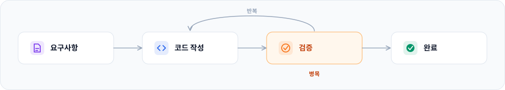
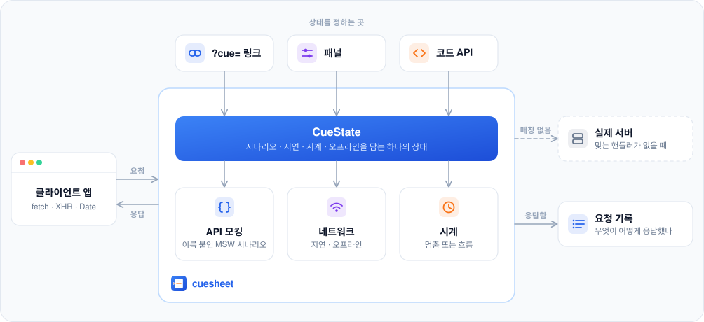

<h1 align="center">
  <picture>
    <source media="(prefers-color-scheme: dark)" srcset="./docs/assets/logo-dark.svg">
    
  </picture>
</h1>
<p align="center">웹 클라이언트의 서버 응답과 브라우저 상태(시간, 네트워크)를 쉽게 맞추고, 링크로 공유합니다.</p>
<p align="center"><a href="./README.md">English</a> · <b>한국어</b></p>

클라이언트 웹에서 화면이 어떻게 보이는지는 대부분 서버의 응답과 브라우저 상태(시간, 네트워크)가 정합니다. cuesheet는 개발과 QA 과정에서 그 의존을 끊으려고 만들었습니다. 핸들러 코드를 고쳐 가며 맞추던 조건을, 링크와 패널에서 고르게 만듭니다.

만들게 된 이야기와 AI, QA, 디자이너와 함께 쓰는 모습은 블로그 글 [MSW로 AI에게 검증까지 맡기는 프론트엔드 개발](https://blog.daeheekim.dev/posts/ai-verified-frontend/)에 정리했습니다.

**쿼리 스트링**

```text
/?cue=getCoupons:Empty                              빈 쿠폰 목록이 옴
/?cue=redeemCoupon:Server error,delay:1500          쿠폰 사용이 1.5초 뒤 500으로 실패
/?cue=time:2026-01-31T23:59:00Z,offline             자정 1분 전, 오프라인
```

**UI 패널**

<p align="center">
  
</p>

## 왜 만들었나

쿠폰 목록을 보여주는 화면을 개발한다고 가정해봅시다.

요구사항은 이렇습니다.

- 쿠폰을 목록으로 보여준다.
- 쿠폰이 10개를 넘으면 10개까지만 보여주고 더보기 버튼을 붙인다.
- 쿠폰이 하나도 없으면 빈 상태로 보여준다.
- 만료된 쿠폰은 "만료됨"으로 표시한다.

서버와는 `GET /coupons`가 아래 인터페이스대로 내려주기로 합의했습니다.

```ts
interface Coupon {
  id: string
  name: string
  discount: string   // 화면에 그대로 쓰는 할인 문구 ('$5 off', '10% off')
  expiresAt: string  // 만료 시각, ISO 8601
  used: boolean
}

type GetCouponsResponse = Coupon[]
```

이제 클라이언트 개발자가 겪는 어려움은 이렇습니다.

1. **서버를 기다립니다.**

   합의만 있고 API는 아직 없습니다. 가짜 데이터를 화면 코드에 박아 두고 시작하면, 나중에 그걸 걷어내면서 같은 화면을 한 번 더 확인해야 합니다.

2. **여러 경우를 보기 어렵습니다.**

   요구사항을 확인하려면 응답이 0개일 때, 1~10개일 때, 10개를 넘을 때가 다 필요합니다. 만료 표시는 지금 시각이 `expiresAt`을 지나야 보이고요.

3. **테스트가 API에 크게 의존합니다.**

   "쿠폰이 없으면 빈 상태"를 테스트하려면 서버 데이터를 비우거나 테스트마다 `fetch`를 스텁해야 합니다. 앞의 방법은 다음 테스트를 깨고, 뒤의 방법은 개발할 때 쓰는 모킹과 점점 따로 놉니다.

4. **개발자가 아니면 테스트하기가 어렵습니다.**

   "쿠폰이 딱 10개면 더보기가 안 보이는 게 맞나요?"를 QA, 디자이너, 기획자가 직접 확인하려면 그 상황을 만들어 줄 사람이 필요합니다. 버그를 발견해도 그 상황 그대로 넘기기 어렵습니다.

## cuesheet를 쓰면

cuesheet는 그 상황마다 이름을 붙여 핸들러 하나에 모아 둡니다. 0개는 `Empty`, 1개는 `One`, 10개 초과는 `Many`입니다.

```ts
// src/mocks/handlers/getCoupons.mock.ts
export default {
  id: 'getCoupons',   // 링크에 쓰는 이름
  label: '쿠폰 목록',
  path: '/coupons',
  handler: [
    { scenario: 'OK', handler: http.get('/coupons', () => HttpResponse.json(coupons)) },        // 첫 시나리오가 기본값
    { scenario: 'Empty', handler: http.get('/coupons', () => HttpResponse.json([])) },
    { scenario: 'One', handler: http.get('/coupons', () => HttpResponse.json(coupons.slice(0, 1))) },
    { scenario: 'Many', handler: http.get('/coupons', () => HttpResponse.json(manyCoupons)) },
  ],
} satisfies CueHandler
```

이름을 붙여 두면 그 상황이 링크가 됩니다. `/?cue=getCoupons:Empty`는 API가 없어도 빈 화면을 열고, QA는 버그를 그 링크째 넘기고, 테스트는 개발할 때 쓰던 그 핸들러를 그대로 엽니다.

```ts
await page.goto('/?cue=getCoupons:Empty')
await expect(page.getByText('쿠폰이 없습니다')).toBeVisible()

await page.goto('/?cue=getCoupons:One')
await expect(page.getByRole('listitem')).toHaveCount(1)
await expect(page.getByRole('button', { name: '더보기' })).toHaveCount(0)

await page.goto('/?cue=getCoupons:Many')
await expect(page.getByRole('listitem')).toHaveCount(10)
await expect(page.getByRole('button', { name: '더보기' })).toBeVisible()
```

Playwright에서 쓰는 방법은 [Playwright로 테스트하기](./docs/testing.ko.md)에 있습니다.

## AI와 함께

클라이언트 기능 개발은 요구사항 → 코드 작성 → 검증 → 완료로 가고, 검증에서 걸리면 코드 작성으로 돌아갑니다. AI에게 맡기면 코드는 빠르게 나오지만, 맞는지 보려면 결국 같은 상황을 만들어야 합니다. 그래서 검증이 병목입니다.

<p align="center">
  
</p>

AI가 그 상황을 재현하는 방법은 두 가지입니다.

**쿼리 스트링** — 앱이 그려지기 전에 상태가 정해집니다. 첫 요청부터 그 상태라서, 가능하면 이쪽을 씁니다.

```ts
await page.goto('/?cue=getCoupons:Empty,delay:0')
```

**`window.__cuesheet__`** — 이미 열린 페이지에서 상태를 바꿉니다. 한 테스트 안에서 상태를 옮겨 갈 때 씁니다.

```ts
await page.waitForFunction(() => window.__cuesheet__ !== undefined)
await page.evaluate(() => window.__cuesheet__!.select('getCoupons', 'Server error'))
```

앱이 개발 환경에서만 cuesheet를 동적 import한다면(권장하는 설정), `window.__cuesheet__`는 `page.goto()`가 기다리는 `load` 이벤트 뒤에 생길 수 있습니다. 그래서 먼저 `waitForFunction`으로 기다립니다.

앱 번들을 거치지 않고 브라우저 쪽에서 바로 다루기 때문에, 에이전트가 앱 코드를 몰라도 상태를 잡을 수 있습니다. 나머지도 에이전트에게 유리한 쪽으로 맞춰져 있습니다.

- **무엇을 바꿀 수 있는지 스스로 알아냅니다.** `window.__cuesheet__`의 `getCatalog()`가 핸들러와 시나리오 이름을 전부 돌려주고, `help()`는 지금 상태까지 한 번에 보여줍니다.
- **틀리면 정답이 같이 옵니다.** 없는 시나리오를 고르면 쓸 수 있는 이름을 알려주며 실패합니다.

  ```text
  [cuesheet] handler 'getCoupons' has no scenario 'Emtpy'. Available: OK, Empty, Server error
  ```

  이렇게 실패하는 건 `select()`입니다. 링크에 같은 오타가 있으면 그 항목만 건너뛰고 화면은 열리며, 같은 이름 목록이 콘솔 경고로 남습니다. 콘솔을 읽는 에이전트(Chrome DevTools MCP, Playwright의 `page.on('console')`)는 이 경고를 보고 링크를 고쳐 다시 엽니다.

- **상태 하나가 문자열 하나입니다.** 실패한 경우를 `?cue=` 값으로 리포트에 적어 두면, 사람은 그 링크로 같은 화면을 엽니다.
- **지연 말고는 무작위가 없습니다.** 같은 링크는 몇 번을 열어도 같은 조건(시나리오, 지연, 시각, 오프라인)으로 열립니다.

에이전트에게 알려주는 건 한 줄이면 됩니다. `cuesheet` 패키지에 에이전트용 안내서가 함께 들어가니(`node_modules/cuesheet/AGENTS.md`), 프로젝트의 에이전트 지침에서 그 파일을 가리키기만 하면 됩니다. 안내서 자체는 [`packages/core/AGENTS.md`](./packages/core/AGENTS.md)이고, [`examples/react`](./examples/react)에는 에이전트용 변경 요청 네 개가 들어 있습니다.

## QA, 디자이너, PM과 함께

같은 링크가 사람 사이에서도 그대로 통하고, 문법을 몰라도 패널이 링크를 만들어 줍니다.

- **상황을 직접 확인합니다.** 빈 상태, 에러, 느린 응답, 오프라인을 패널에서 고르면 되니, 상황을 만들어 줄 개발자가 필요 없습니다.
- **버그 제보에 상황이 같이 담깁니다.** 패널의 **Copy URL** 버튼이 지금 상황을 링크로 복사합니다. "만료 표시가 이상해요: `/?cue=getCoupons:Many,time:2026-03-01T00:00:00Z`"처럼 제보하고, 고친 뒤에도 같은 링크로 확인합니다.
- **디자인 검수는 시안의 화면마다 링크 하나입니다.**

  ```text
  빈 상태    /?cue=getCoupons:Empty
  에러       /?cue=getCoupons:Server error
  로딩       /?cue=getCoupons:OK,delay:30000
  ```

- **공용 dev 서버에서도 서로 방해하지 않습니다.** 상태는 각자의 브라우저에만 있어서, QA가 에러 상황을 열어도 다른 사람의 화면은 그대로입니다. 실제 dev API로 보려면 `?cue=off`로 엽니다.

시나리오는 링크가 정하는 것 중 하나일 뿐입니다. 응답 지연과 시간, 오프라인도 같은 자리에서 정합니다.

## 무엇을 제어할 수 있나

| 조건 | 무엇이 바뀌나 | 예 |
|---|---|---|
| API 응답 | 그 API에 이름 붙여 둔 응답 중 하나를 고릅니다. 빈 목록, 에러, 항목이 많은 목록처럼 | `getCoupons:Empty` |
| 응답 지연 | 응답이 도착하기까지 걸리는 시간. 고정값이나 범위(그 사이에서 무작위) | `delay:800-2000` |
| 시간 | 앱이 보는 현재 시각. 그 시각에 멈춰 두거나, 거기서부터 흐르게 | `time:2026-01-31T09:00:00Z` |
| 네트워크 | 요청이 네트워크 오류처럼 실패합니다 | `offline` |

네 가지 모두 `?cue=` 링크, 패널, 코드(`cuesheet.select()`, `cuesheet.patch()`) 어디서든 같은 값을 정합니다. 링크 문법은 [`?cue=` 링크](./docs/cue-links.ko.md)에, 메서드와 나머지(핸들러 하나만 끄기, 전부 끄기, 요청 기록)는 [API 레퍼런스](./docs/api.ko.md)에 있습니다.

## 어떻게 동작하나

cuesheet는 MSW의 [Dynamic mock scenarios](https://mswjs.io/guides/best-practices/dynamic-mock-scenarios) 가이드에서 출발했습니다. 이 가이드는 `?scenario=` 쿼리 파라미터로 핸들러 묶음을 고릅니다. cuesheet는 이를 페이지 단위가 아니라 API 단위로 고르게 하고, 패널과 지연, 시간, 오프라인을 더했습니다.

MSW에서는 모킹 응답을 핸들러에 정의합니다. 빈 목록과 500과 느린 응답을 오갈 때마다 그 핸들러를 고치는 방식이면, 같은 화면을 다시 보려는 사람도 코드를 고쳐야 합니다.

cuesheet는 응답 자체는 MSW에 맡깁니다. MSW 핸들러를 평소처럼 작성하면, cuesheet가 응답마다 이름을 붙여 바꿔 끼우고(시나리오), 그 위에 지연·시계·오프라인을 얹습니다. 이 설정들이 상태 객체 하나이고, 링크·패널·코드가 같은 상태에 씁니다. 응답한 요청은 따로 기록으로 남고, 링크에는 담기지 않습니다.

<p align="center">
  
</p>

서비스 워커를 쓰지 않는 이유까지 더 자세히는 [동작 원리](./docs/how-it-works.ko.md)에 있습니다.

## 빠르게 시작하기

```bash
npm install -D cuesheet msw
```

핸들러를 쓰고 인스턴스를 만듭니다.

```ts
// src/cuesheet.ts
import { createCuesheet, http, HttpResponse } from 'cuesheet'

export const cuesheet = createCuesheet({
  baseUrl: 'https://api.example.com',
  defaultEnabled: true,          // 저장된 상태가 없으면 켜 둠
  storage: window.localStorage,  // 빼면 메모리에만 둡니다
  handlers: [
    {
      id: 'getCoupons',
      label: '쿠폰 목록',
      path: '/coupons',
      handler: [
        { scenario: 'OK', handler: http.get('/coupons', () => HttpResponse.json([
          { id: 'welcome', name: '웰컴 쿠폰', discount: '$5 off', expiresAt: '2026-02-28T00:00:00Z', used: false },
        ])) },
        { scenario: 'Empty', handler: http.get('/coupons', () => HttpResponse.json([])) },
      ],
    },
  ],
})
```

앱이 그려지기 전에 시작합니다. 그래야 cuesheet가 준비되기 전에 요청이 나가거나 날짜를 읽는 일이 없습니다.

```ts
// src/main.ts
import { cuesheet } from './cuesheet'

cuesheet.applyUrlParams()  // ?cue=를 먼저 읽고
cuesheet.start()           // fetch / XHR 가로채기와 시계를 시작합니다
```

`/?cue=getCoupons:Empty`로 열면 목록이 비어 있습니다.

React라면 패널로 같은 걸 화면에서 조작할 수 있습니다.

```bash
npm install -D @cuesheet/react
```

```tsx
// App.tsx
import { useEffect } from 'react'
import { CuesheetPanel } from '@cuesheet/react'
import { cuesheet } from './cuesheet'

export function App() {
  // 상태가 바뀌면 다시 불러오기 (여기서는 TanStack Query, 쓰는 데이터 로더에 맞추면 됩니다)
  useEffect(() => cuesheet.subscribe(() => queryClient.invalidateQueries()), [])

  return (
    <>
      <CouponApp />
      <CuesheetPanel cuesheet={cuesheet} />
    </>
  )
}
```

상용 빌드에서 cuesheet를 번들에서 제외하는 방법은 [프로덕션에서 제외하기](./docs/getting-started.ko.md#프로덕션에서-빼기)를 참고하세요.

### 앱이 커지면: API마다 파일 하나, 개발 빌드에서만 불러오기

핸들러가 몇 개를 넘어가면 파일 하나에 핸들러 하나씩 두고, 폴더를 glob으로 등록하세요.

```ts
// src/mocks/handlers/getCoupons.mock.ts — 파일 하나에 핸들러 하나
import { http, HttpResponse, type CueHandler } from 'cuesheet'

export default {
  id: 'getCoupons',
  label: '쿠폰 목록',
  path: '/coupons',
  handler: [
    { scenario: 'OK', handler: http.get('/coupons', () => HttpResponse.json([
      { id: 'welcome', name: '웰컴 쿠폰', discount: '$5 off', expiresAt: '2026-02-28T00:00:00Z', used: false },
    ])) },
    { scenario: 'Empty', handler: http.get('/coupons', () => HttpResponse.json([])) },
  ],
} satisfies CueHandler
```

```ts
// src/mocks/cuesheet.ts — 인스턴스는 별도 모듈에
import { collectHandlers, createCuesheet } from 'cuesheet'

export const cuesheet = createCuesheet({
  baseUrl: 'https://api.example.com',
  handlers: collectHandlers(import.meta.glob('./handlers/*.mock.ts', { eager: true })),  // Vite. webpack은 require.context
  storage: window.localStorage,
  defaultEnabled: true,
})

cuesheet.applyUrlParams()
cuesheet.start()
```

그다음 이 모듈을 개발 빌드에서만 참인 조건 뒤에서 동적 import로 불러오고, 준비되면 그립니다. 번들러가 프로덕션 빌드에서 이 분기를 지우므로 결과물에는 cuesheet도, msw도, 모킹 데이터도 남지 않습니다.

```tsx
// src/main.tsx
async function startCuesheet() {
  if (!import.meta.env.DEV) return undefined
  const { cuesheet } = await import('./mocks/cuesheet')
  return cuesheet
}

void startCuesheet().then((cuesheet) => {
  createRoot(document.getElementById('root')!).render(<App cuesheet={cuesheet} />)
})
```

```tsx
// App.tsx — 프로덕션 빌드에서 cuesheet는 undefined이고, 패널은 개발 서버에서만 불러옵니다
const CuesheetPanel = import.meta.env.DEV
  ? lazy(() => import('@cuesheet/react').then((module) => ({ default: module.CuesheetPanel })))
  : undefined

useEffect(() => cuesheet?.subscribe(() => queryClient.invalidateQueries()), [cuesheet])

return (
  <>
    <CouponApp />
    {CuesheetPanel !== undefined && cuesheet !== undefined && (
      <Suspense fallback={null}><CuesheetPanel cuesheet={cuesheet} /></Suspense>
    )}
  </>
)
```

모킹을 프로덕션에서 빼는 건 앱의 몫입니다. cuesheet는 이 동적 import로만 불러오세요. `cuesheet.select('getCoupons', 'Empty')`가 자동완성되고 오타가 컴파일에서 걸리게 하려면 이름을 `d.ts`에 선언하세요([시나리오 이름 타입](./docs/handlers.ko.md#시나리오-이름-타입)).

Next.js와 다른 설정은 [시작하기](./docs/getting-started.ko.md)를 보세요. 다 붙인 앱이 어떻게 생겼는지는 [`examples/react`](./examples/react)에 있습니다.

## 패키지

| 패키지 | 하는 일 |
|---|---|
| [`cuesheet`](./packages/core) | 가로채기, 상태, 지연, 시계, 오프라인, 요청 기록. 프레임워크 무관 |
| [`@cuesheet/react`](./packages/react) | 조작 패널 |

`msw`는 peer dependency이며 지원 범위는 `^2.1.3`입니다. 핸들러는 MSW로 작성합니다. 2.1.3부터 최신까지 2.x 마이너를 전부 확인했고, `getResponse`가 2.1.3에서 추가되므로 2.1.2 이하는 동작하지 않습니다. `pnpm --filter cuesheet test:msw`가 그 범위의 표본을 계속 검증합니다.

## 문서

- [시작하기](./docs/getting-started.ko.md): Vite, 다른 번들러, Next.js, 프로덕션에서 빼기
- [핸들러와 시나리오](./docs/handlers.ko.md): 모킹 작성, API마다 파일 하나, 시나리오 이름 타입
- [`?cue=` 링크](./docs/cue-links.ko.md): 문법, 링크에 담기는 것과 안 담기는 것
- [Playwright로 테스트하기](./docs/testing.ko.md): 상태로 열기, 요청 확인, 시계
- [API 레퍼런스](./docs/api.ko.md): 모든 옵션, 메서드, 타입
- [동작 원리](./docs/how-it-works.ko.md): 요청 처리 흐름, 서비스 워커를 안 쓰는 이유, 한계

## 예제

- [`examples/react`](./examples/react): 쿠폰 앱에 변경 요청 네 건이 들어오고, AI 에이전트가 구현하고, Playwright가 cuesheet 상태와 요청 기록으로 하나씩 확인합니다.
- [`examples/nextjs`](./examples/nextjs): 같은 앱을 Next.js App Router에 붙인 예제입니다.

```bash
pnpm install && pnpm dev:react     # http://localhost:5173
```

## 기여하기

[CONTRIBUTING.md](./CONTRIBUTING.md)를 보세요. 라이선스는 MIT입니다.

---

**다음:** [시작하기](./docs/getting-started.ko.md) · [전체 문서](./docs/index.ko.md)
