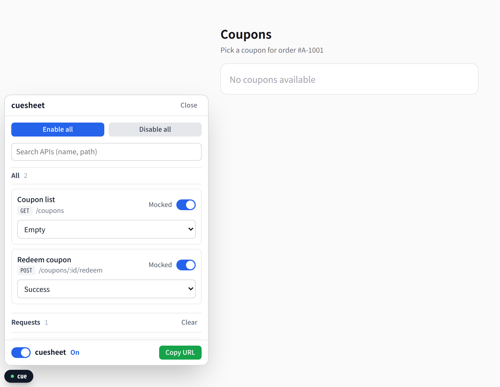
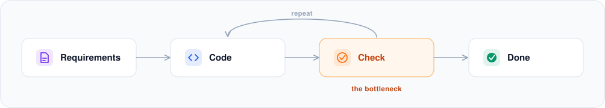
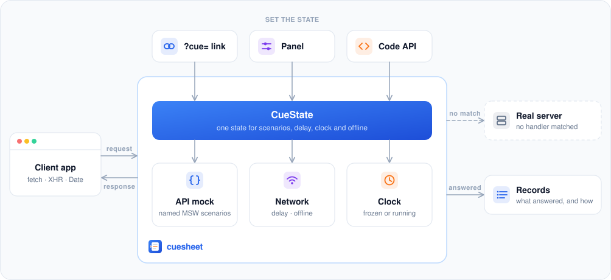

<h1 align="center">
  <picture>
    <source media="(prefers-color-scheme: dark)" srcset="./docs/assets/logo-dark.svg">
    
  </picture>
</h1>
<p align="center">Set a web client's server responses and browser state (time, network) with ease, and share them as a link.</p>
<p align="center"><b>English</b> · <a href="./README.ko.md">한국어</a></p>

In a client web app, what a screen looks like is mostly decided by the server's response and the browser state (time, network). cuesheet exists to break that dependency while you develop and QA: the conditions you used to arrange by editing handler code become something you pick from a link or the panel.

The story behind it, and how it plays out with AI, QA and designers: [Handing Frontend Checks Over to AI with MSW](https://blog.daeheekim.dev/en/posts/ai-verified-frontend/).

**Query string**

```text
/?cue=getCoupons:Empty                              the coupon list comes back empty
/?cue=redeemCoupon:Server error,delay:1500          redeeming fails with a 500, 1.5 s late
/?cue=time:2026-01-31T23:59:00Z,offline             one minute before midnight, offline
```

**UI panel**

<p align="center">
  
</p>

## Why

Say we're building a screen that shows a list of coupons.

The requirements:

- Show the coupons as a list.
- With more than ten, show the first ten and a "More" button.
- With no coupons at all, show the empty state.
- Mark an expired coupon as expired.

The contract with the server is agreed: `GET /coupons` answers with the interface below.

```ts
interface Coupon {
  id: string
  name: string
  discount: string   // shown as-is ('$5 off', '10% off')
  expiresAt: string  // expiry, ISO 8601
  used: boolean
}

type GetCouponsResponse = Coupon[]
```

From here, what the client developer runs into:

1. **You wait for the server.**

   There's a contract but no API yet. Start by pinning fake data into the screen, and you'll check the same screen again later, when you take that data back out.

2. **Seeing every case is hard.**

   Those requirements need responses covering none, one to ten, and more than ten coupons. And the expired mark only shows once the current time is past `expiresAt`.

3. **Tests lean heavily on the API.**

   To test "no coupons, so an empty screen", you either clear the data on the server or stub `fetch` in the test. The first breaks the next test, and the second drifts away from the mocks you use while developing.

4. **It's hard to test without a developer.**

   "With exactly ten coupons, is it right that there's no More button?" — for QA, designers and planners to check that themselves, someone has to build the situation. And a bug they hit is hard to hand back in the state it happened in.

## With cuesheet

cuesheet gives each of those situations a name and keeps them on one handler: none is `Empty`, one is `One`, more than ten is `Many`.

```ts
// src/mocks/handlers/getCoupons.mock.ts
export default {
  id: 'getCoupons',   // the name a link uses
  label: 'Coupon list',
  path: '/coupons',
  handler: [
    { scenario: 'OK', handler: http.get('/coupons', () => HttpResponse.json(coupons)) },        // the first scenario is the default
    { scenario: 'Empty', handler: http.get('/coupons', () => HttpResponse.json([])) },
    { scenario: 'One', handler: http.get('/coupons', () => HttpResponse.json(coupons.slice(0, 1))) },
    { scenario: 'Many', handler: http.get('/coupons', () => HttpResponse.json(manyCoupons)) },
  ],
} satisfies CueHandler
```

Once a situation has a name, it has a link. `/?cue=getCoupons:Empty` opens the empty screen with no API behind it, QA hands a bug back as that link, and a test opens the very handler you develop against.

```ts
await page.goto('/?cue=getCoupons:Empty')
await expect(page.getByText('No coupons available')).toBeVisible()

await page.goto('/?cue=getCoupons:One')
await expect(page.getByRole('listitem')).toHaveCount(1)
await expect(page.getByRole('button', { name: 'More' })).toHaveCount(0)

await page.goto('/?cue=getCoupons:Many')
await expect(page.getByRole('listitem')).toHaveCount(10)
await expect(page.getByRole('button', { name: 'More' })).toBeVisible()
```

[Testing with Playwright](./docs/testing.md) covers the rest of that side.

## With an AI

Building a client feature runs requirements → code → check → done, and a failed check sends you back to writing code. Hand the code to an AI and it arrives fast, but seeing whether it's right still means building the same situations. That's what makes checking the bottleneck.

<p align="center">
  
</p>

There are two ways for an AI to put the app in one of those situations.

**Query string** — the state is in place before the app renders, so even the first request sees it. Prefer this one.

```ts
await page.goto('/?cue=getCoupons:Empty,delay:0')
```

**`window.__cuesheet__`** — change the state on a page that's already open, when one test moves between states.

```ts
await page.waitForFunction(() => window.__cuesheet__ !== undefined)
await page.evaluate(() => window.__cuesheet__!.select('getCoupons', 'Server error'))
```

When the app loads cuesheet with a dev-only dynamic import (the recommended setup), `window.__cuesheet__` can appear after the `load` event that `page.goto()` waits for, hence the `waitForFunction` first.

Both work from the browser side, without going through the app bundle, so an agent can set the state without knowing the app's code. The rest is built the same way:

- **It can find out what it may change.** `getCatalog()` on `window.__cuesheet__` returns every handler with its scenario names, and `help()` prints those plus the current state.
- **A mistake comes back with the answer.** Picking a scenario that doesn't exist fails with the valid ones:

  ```text
  [cuesheet] handler 'getCoupons' has no scenario 'Emtpy'. Available: OK, Empty, Server error
  ```

  `select()` throws this. A link with the same typo still opens, skipping that entry and logging the same names as a console warning, so an agent that reads the console (Chrome DevTools MCP, Playwright's `page.on('console')`) sees it and opens the right link.

- **A whole state is one string.** An agent can put the `?cue=` value of a failing case in its report, and a person opens the same screen from it.
- **Nothing is random except delay.** The same link opens under the same conditions (scenarios, delay, clock, offline) every time.

Pointing an agent at it takes one line: the `cuesheet` package ships a guide for agents (`node_modules/cuesheet/AGENTS.md`), so your project's agent instructions only have to name that file. The guide itself is [`packages/core/AGENTS.md`](./packages/core/AGENTS.md), and [`examples/react`](./examples/react) carries four change requests written for agents.

## With QA, designers and PMs

The same links work between people, and the panel builds them without anyone learning the syntax.

- **They check a situation themselves.** The empty state, an error, a slow response, offline — picked from the panel, no developer needed to set it up.
- **A bug report carries its state.** The panel's **Copy URL** button copies the current situation as a link, so a report reads "the expired mark looks wrong: `/?cue=getCoupons:Many,time:2026-03-01T00:00:00Z`", and the fix is checked with the same link.
- **A design review gets one link per mocked state.**

  ```text
  Empty     /?cue=getCoupons:Empty
  Error     /?cue=getCoupons:Server error
  Loading   /?cue=getCoupons:OK,delay:30000
  ```

- **A shared dev server stays shared.** The state lives in each person's browser, so QA opening an error doesn't change anyone else's screen. `?cue=off` sends everything to the real dev API.

A scenario is only one of the things a link decides; response delay, time and offline sit in the same place.

## What you can control

| Condition | What changes | Example |
|---|---|---|
| API response | Picks one of the responses you named for that API: an empty list, an error, a long list | `getCoupons:Empty` |
| Response delay | How long a response takes to arrive — a fixed value, or a range it's picked from | `delay:800-2000` |
| Time | The current time as the app sees it: frozen at that moment, or running on from it | `time:2026-01-31T09:00:00Z` |
| Network | Requests fail the way they do with no network | `offline` |

All four take the same value from a `?cue=` link, the panel or code (`cuesheet.select()`, `cuesheet.patch()`). The link syntax is in [`?cue=` links](./docs/cue-links.md); the methods and the rest — turning one handler off, turning everything off, reading request records — are in the [API reference](./docs/api.md).

## How it works

cuesheet grew out of MSW's [Dynamic mock scenarios](https://mswjs.io/guides/best-practices/dynamic-mock-scenarios) guide, which picks a set of handlers from a `?scenario=` query parameter. cuesheet takes that per API rather than per page, and adds a panel, delay, time and offline.

With MSW you define the mock responses in handlers. If moving between an empty list, a 500 and a slow response means editing those handlers, then anyone who wants the same screen back has to edit code too.

cuesheet leaves the answering to MSW. You write ordinary MSW handlers; cuesheet names their responses and switches between them (scenarios), and puts delay, clock and offline on top. Those settings are one state object that the link, the panel and the code all write to. Answered requests are kept separately as records, and a link doesn't carry them.

<p align="center">
  
</p>

More detail, including why there's no service worker: [How it works](./docs/how-it-works.md).

## Quick start

```bash
npm install -D cuesheet msw
```

Write the handlers and create the instance in one module:

```ts
// src/cuesheet.ts
import { createCuesheet, http, HttpResponse } from 'cuesheet'

export const cuesheet = createCuesheet({
  baseUrl: 'https://api.example.com',
  defaultEnabled: true,          // on when nothing is saved yet
  storage: window.localStorage,  // omit to keep the state in memory only
  handlers: [
    {
      id: 'getCoupons',
      label: 'Coupon list',
      path: '/coupons',
      handler: [
        { scenario: 'OK', handler: http.get('/coupons', () => HttpResponse.json([
          { id: 'welcome', name: 'Welcome', discount: '$5 off', expiresAt: '2026-02-28T00:00:00Z', used: false },
        ])) },
        { scenario: 'Empty', handler: http.get('/coupons', () => HttpResponse.json([])) },
      ],
    },
  ],
})
```

Start it before the app renders, so nothing is requested and no date is read before cuesheet is ready:

```ts
// src/main.ts
import { cuesheet } from './cuesheet'

cuesheet.applyUrlParams()  // read ?cue= first
cuesheet.start()           // then intercept fetch / XHR and install the clock
```

Open `/?cue=getCoupons:Empty` and the list is empty.

For React, the panel gives the same control on screen:

```bash
npm install -D @cuesheet/react
```

```tsx
// App.tsx
import { useEffect } from 'react'
import { CuesheetPanel } from '@cuesheet/react'
import { cuesheet } from './cuesheet'

export function App() {
  // refetch when the state changes (TanStack Query here; use whatever loads your data)
  useEffect(() => cuesheet.subscribe(() => queryClient.invalidateQueries()), [])

  return (
    <>
      <CouponApp />
      <CuesheetPanel cuesheet={cuesheet} />
    </>
  )
}
```

To ensure cuesheet is excluded from production bundles, see [Keeping it out of production](./docs/getting-started.md#keeping-it-out-of-production).

### As the app grows: one file per API, dev-only loading

Once there are more than a couple of handlers, put one handler in each file and register the folder with a glob:

```ts
// src/mocks/handlers/getCoupons.mock.ts — one handler per file
import { http, HttpResponse, type CueHandler } from 'cuesheet'

export default {
  id: 'getCoupons',
  label: 'Coupon list',
  path: '/coupons',
  handler: [
    { scenario: 'OK', handler: http.get('/coupons', () => HttpResponse.json([
      { id: 'welcome', name: 'Welcome', discount: '$5 off', expiresAt: '2026-02-28T00:00:00Z', used: false },
    ])) },
    { scenario: 'Empty', handler: http.get('/coupons', () => HttpResponse.json([])) },
  ],
} satisfies CueHandler
```

```ts
// src/mocks/cuesheet.ts — the instance, in a module of its own
import { collectHandlers, createCuesheet } from 'cuesheet'

export const cuesheet = createCuesheet({
  baseUrl: 'https://api.example.com',
  handlers: collectHandlers(import.meta.glob('./handlers/*.mock.ts', { eager: true })),  // Vite; webpack: require.context
  storage: window.localStorage,
  defaultEnabled: true,
})

cuesheet.applyUrlParams()
cuesheet.start()
```

Then load that module with a dynamic import behind a dev-only flag, and render once it's ready. The bundler drops the branch from production builds, so they contain no cuesheet, no msw and no mock data:

```tsx
// src/main.tsx
async function startCuesheet() {
  if (!import.meta.env.DEV) return undefined
  const { cuesheet } = await import('./mocks/cuesheet')
  return cuesheet
}

void startCuesheet().then((cuesheet) => {
  createRoot(document.getElementById('root')!).render(<App cuesheet={cuesheet} />)
})
```

```tsx
// App.tsx — cuesheet is undefined in production builds; the panel is loaded on the dev server only
const CuesheetPanel = import.meta.env.DEV
  ? lazy(() => import('@cuesheet/react').then((module) => ({ default: module.CuesheetPanel })))
  : undefined

useEffect(() => cuesheet?.subscribe(() => queryClient.invalidateQueries()), [cuesheet])

return (
  <>
    <CouponApp />
    {CuesheetPanel !== undefined && cuesheet !== undefined && (
      <Suspense fallback={null}><CuesheetPanel cuesheet={cuesheet} /></Suspense>
    )}
  </>
)
```

Keeping mocks out of production is up to the app: import cuesheet only through that dynamic import. To have `cuesheet.select('getCoupons', 'Empty')` autocomplete and a typo fail to compile, declare the names in a `d.ts` ([Typed scenario names](./docs/handlers.md#typed-scenario-names)).

For Next.js and other setups, see [Getting started](./docs/getting-started.md). For a finished app with all of it in place, see [`examples/react`](./examples/react).

## Packages

| Package | What it does |
|---|---|
| [`cuesheet`](./packages/core) | Interception, state, delay, clock, offline, records. Works with any framework |
| [`@cuesheet/react`](./packages/react) | The control panel |

`msw` is a peer dependency (^2.1.3). Every 2.x minor from 2.1.3 on was checked against the suite; 2.1.2 and below don't work, since `getResponse` arrives in 2.1.3. `pnpm --filter cuesheet test:msw` keeps a sample of that range green.

## Documentation

- [Getting started](./docs/getting-started.md): Vite, other bundlers, Next.js, keeping it out of production
- [Handlers and scenarios](./docs/handlers.md): writing mocks, one file per API, typed scenario names
- [`?cue=` links](./docs/cue-links.md): the syntax, and what a link does and doesn't carry
- [Testing with Playwright](./docs/testing.md): opening a state, checking requests, the clock
- [API reference](./docs/api.md): every option, method and type
- [How it works](./docs/how-it-works.md): the request pipeline, why there's no service worker, limits

## Examples

- [`examples/react`](./examples/react): a coupon app gets four change requests, an AI agent implements them, and Playwright checks each one using cuesheet states and request records.
- [`examples/nextjs`](./examples/nextjs): the same app in the Next.js App Router.

```bash
pnpm install && pnpm dev:react     # http://localhost:5173
```

## Contributing

See [CONTRIBUTING.md](./CONTRIBUTING.md). MIT licensed.

---

**Next:** [Getting started](./docs/getting-started.md) · [All docs](./docs/index.md)
